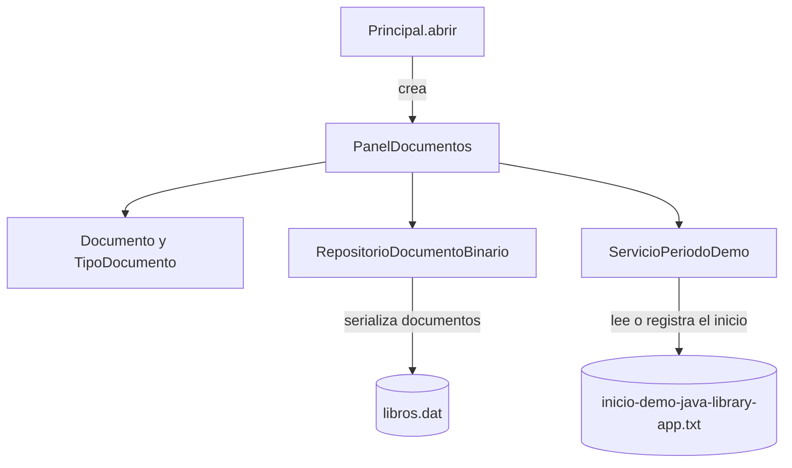

# Arquitectura de Biblioteca Java

## Del arranque a los archivos

## Dónde buscar

| Paquete dentro de `com.example.library` | Responsabilidad |
|---|---|
| Paquete raíz | `Principal.abrir` crea la ventana y le entrega al panel las dos dependencias concretas. |
| `ui` | `PanelDocumentos` recibe los clics, llama al dominio o al repositorio y muestra el resultado. |
| `domain` | `Documento` valida los datos. `TipoDocumento` limita los tipos que el formulario ofrece. |
| `repository` | `RepositorioDocumentoBinario` lee y reemplaza el archivo relativo `src/com/example/library/data/catalog/libros.dat`. |
| `service` | `ServicioPeriodoDemo` consulta el reloj y guarda el instante inicial en el subdirectorio `java-library-app` de la carpeta temporal de Java. |

## Seguí el primer arranque

1. Desde la raíz, `.\comp.ps1` reúne los fuentes y ejecuta `javac --release 17` con salida en `out`. `.\run.ps1` usa ese directorio como ruta de clases. La aplicación usa Swing/AWT y la biblioteca estándar.
2. `Principal.main` agenda `Principal::abrir` en el hilo de eventos de Swing. Allí se construyen el `JFrame`, el repositorio, el servicio y el panel.
3. El constructor de `PanelDocumentos` consulta `demo.estaExpirada()` y llama a `mostrarCatalogo("")`. Cada documento leído produce una tarjeta. Un catálogo vacío tiene su propio mensaje.
4. Al incorporarse a la interfaz, `addNotify` pone en marcha el temporizador. `removeNotify` lo detiene cuando el panel pierde su conexión con la interfaz nativa.

## Tres preguntas del profesor

1. **¿Dónde agregás una regla que debe cumplirse incluso sin formulario?** En el constructor de `Documento`. La fábrica del formulario y quien construye el objeto directamente pasan por ese constructor.
2. **¿Quién decide cuándo vence la demo y quién aplica el resultado?** El servicio compara los instantes. El panel habilita o bloquea las acciones de escritura y conserva la consulta. El repositorio desconoce la demo.
3. **¿Por qué puede costar un redibujado si crece el archivo?** `mostrarCatalogo` lee el catálogo en el mismo hilo que atiende los eventos. Una lectura lenta demora la atención de clics y el repintado.
