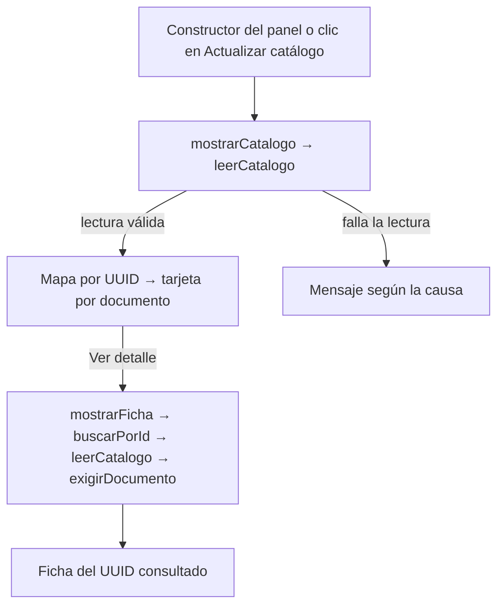
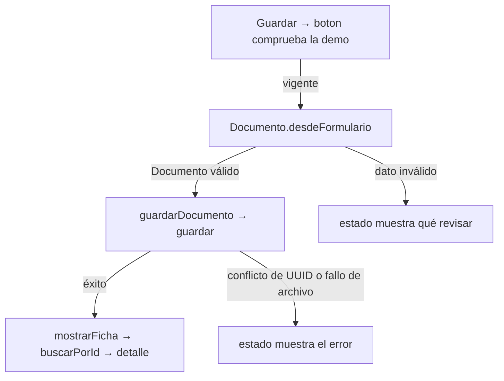
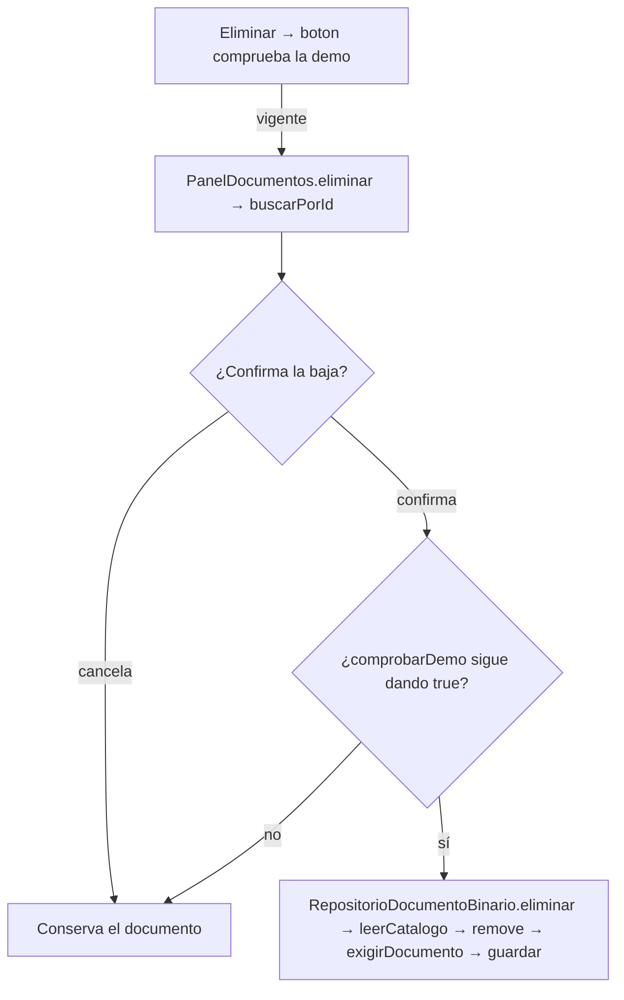

# Tres recorridos que podés explicar señalando el código

## 1. Consultar catálogo y abrir una ficha

`leerCatalogo()` exige una `ArrayList` con elementos `Documento` e identificadores únicos. Una lista vacía muestra un aviso. Si falta el archivo, se admite el primer alta con la demo vigente. Un archivo ilegible bloquea el alta. Si el UUID desapareció entre la lista y el clic, `mostrarFicha` vuelve al catálogo e informa el error.
**Pregunta.** Si otra instancia borra un documento, ¿por qué su tarjeta todavía puede verse y su ficha ya no abrirse?

## 2. Crear o editar

El formulario entrega tipo y textos. El alta genera un UUID y pasa `nuevo=true`. La edición reutiliza el UUID. `desdeFormulario` convierte los números y el constructor exige id, tipo y título. Valoración y páginas admiten ausencia o enteros de 1–5 y 1–999. El repositorio rechaza un alta duplicada o una edición inexistente. Tras guardar vuelve a leer el detalle.
**Pregunta.** Si escribís «seis» en valoración, ¿qué llamada falla y por qué el archivo conserva su contenido?

## 3. Eliminar durante la demo

`RepositorioDocumentoBinario.eliminar(UUID)` devuelve `void`. Si termina, el panel refresca el catálogo con un aviso. Si el id desapareció o falla el archivo, el botón captura `IllegalStateException`. La segunda comprobación cubre el tiempo que el usuario dejó abierto el diálogo.
**Pregunta.** Si la demo vence con la confirmación abierta, ¿se llega a ejecutar `guardar`?
