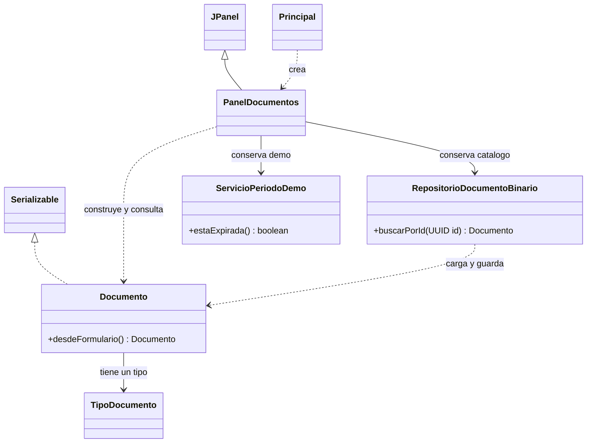

# UML de las clases principales

| Tipo propio | Qué aporta y dónde se comprueba |
|---|---|
| `Principal` | `abrir` crea los objetos y conecta la ventana con el panel. |
| `PanelDocumentos` | `mostrarFicha` arma el detalle o el formulario. Los botones que construye coordinan cada operación. |
| `Documento` | Su constructor protege los datos de cada registro, desde el identificador hasta los rangos numéricos. |
| `TipoDocumento` | Cada constante representa un tipo permitido. `toString` aporta el nombre visible. |
| `RepositorioDocumentoBinario` | `buscarPorId` entrega un documento. `guardarDocumento` y `eliminar` persisten cambios. |
| `ServicioPeriodoDemo` | `estaExpirada` compara el inicio guardado con el instante actual. |

**Cómo leer las flechas.** `PanelDocumentos` hereda de `JPanel`. `Documento` implementa la interfaz marcadora `Serializable`. La flecha continua hacia el repositorio señala una asociación porque el panel lo conserva en un campo. La punteada desde `Principal` indica una dependencia al construir el panel.

## Tres preguntas para defender la POO

1. **¿Qué detalle queda encapsulado?** El panel llama a `guardarDocumento`. El método privado `guardar` decide cómo escribir el temporal. Esa operación pública abstrae los pasos de persistencia.
2. **¿Dónde se ve el polimorfismo en ejecución?** Swing trata al panel como componente. Al incorporarlo llama a su versión de `addNotify`, que arranca el temporizador después de llamar a `super.addNotify()`.
3. **¿Libro y artículo científico tienen clases distintas?** Ambos son objetos `Documento`. Su componente `_tipo` contiene una constante de `TipoDocumento`. Agregar un tipo con los mismos campos requiere otra constante.
